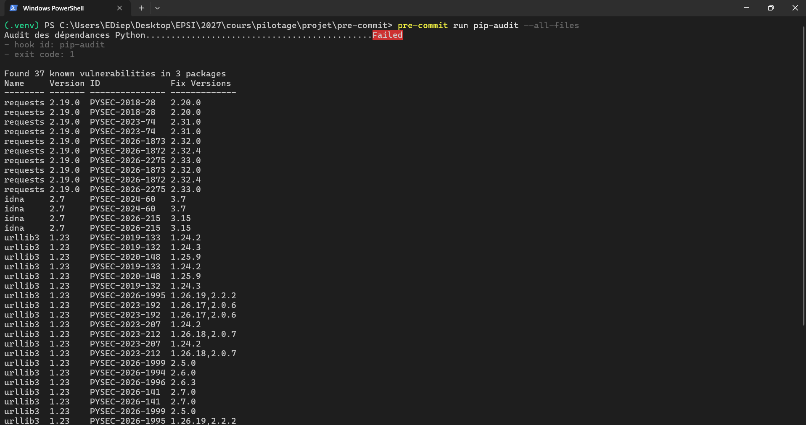
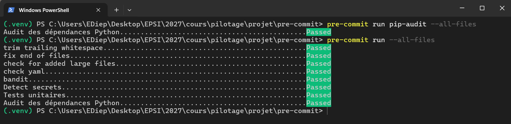
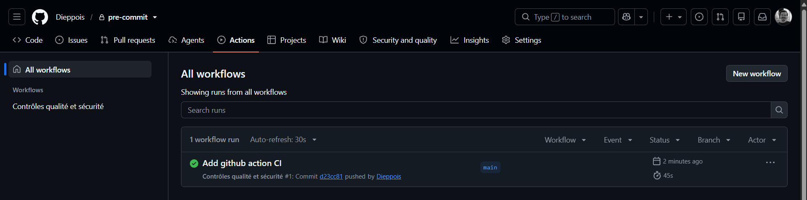
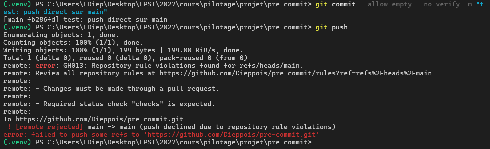
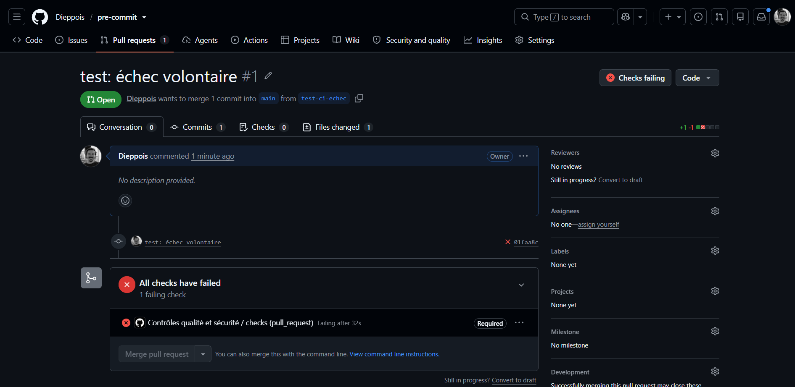
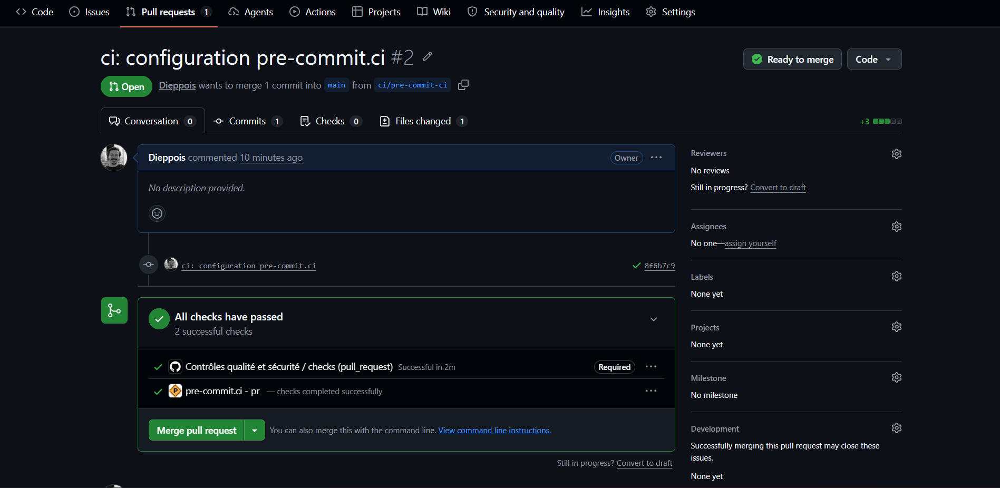

# TP 1 - Sécuriser un dépôt Python avec les hooks pre-commit

Auteur : Dieppois
Dépôt : https://github.com/Dieppois/pre-commit

## 1. Analyse du code initial

### Problèmes de qualité

- `import os` est importé mais pas utilisé.
- Une seule ligne vide avant `def` au lieu de deux (PEP 8).
- Pas de docstring, et le nom `get_message` ne décrit pas ce que fait la fonction.
- La variable `password` est déclarée mais pas utilisée.
- La fonction mélange saisie, calcul et affichage, elle n'est donc pas testable.
- Aucune gestion d'erreur si l'expression est invalide.

### Risques de sécurité

- Mot de passe écrit en dur dans le code source.
- `eval()` exécuté sur une saisie utilisateur.
- Aucune validation de l'entrée.

### Pourquoi `eval()` est dangereux

`eval()` exécute la chaîne reçue comme du code Python, avec les droits du programme. Un utilisateur peut donc lancer des commandes système (`__import__('os').system(...)`), lire des fichiers ou des secrets, ou bloquer le programme (`9**9**9`).

### Pourquoi un mot de passe ne doit pas être dans le code

Toute personne qui a accès au dépôt peut le lire. Il reste dans l'historique Git même après suppression. Le changer impose de modifier le code et de redéployer.

### Correction proposée

- Le mot de passe est lu depuis la variable d'environnement `APP_PASSWORD` (fonction `get_password()`), jamais affiché.
- `eval()` est remplacé par `calculate(a, b, operation)`, qui n'autorise que `add`, `subtract`, `multiply` et `divide`.

## 2. Baseline detect-secrets

Le baseline généré était vide (`"results": {}`), donc aucun faux positif à examiner. `detect-secrets scan` n'analyse que les fichiers suivis par Git, et le baseline a été créé avant le premier `git add`.

## 3. Audit des dépendances

Test avec `requests==2.19.0` ajouté temporairement dans `requirements.txt`.

| Paquet | Version | Vulnérabilité | Version corrigée | Impact potentiel | Action |
|---|---|---|---|---|---|
| requests | 2.19.0 | PYSEC-2018-28 | 2.20.0 | Fuite de l'en-tête `Authorization` lors d'une redirection HTTPS vers HTTP | Mettre à jour requests |
| requests | 2.19.0 | PYSEC-2023-74 | 2.31.0 | Fuite de l'en-tête `Proxy-Authorization` | Mettre à jour requests |
| urllib3 | 1.23 | PYSEC-2023-192 | 1.26.17 | Cookie transmis lors d'une redirection vers un autre domaine | Corrigé par la mise à jour de requests |
| idna | 2.7 | PYSEC-2024-60 | 3.7 | Déni de service | Corrigé par la mise à jour de requests |

L'application n'utilise pas `requests`, l'impact réel est donc nul. Action : retrait de `requests==2.19.0`.

## 4. Exécution complète des contrôles

## 5. CI et protection de main

Workflow : `.github/workflows/securite.yml`

Push direct sur `main` refusé par la règle GitHub :

Pull request bloquée par la CI en échec :

Pull request avec pre-commit.ci :

## 6. Analyse de deux problèmes détectés

### Problème 1 : secret dans un commentaire

detect-secrets a bloqué le premier commit sur `app.py`. L'ancien code, avec le mot de passe, avait été laissé en commentaire. Un commentaire est commité comme le reste du code.

Correction : suppression du code commenté. Le baseline n'a pas été modifié pour faire passer le commit.

### Problème 2 : dépendances vulnérables

pip-audit a signalé des vulnérabilités dans `requests 2.19.0`, mais aussi dans `urllib3` et `idna`, installés automatiquement par `requests` (dépendances transitives).

Correction : retrait de la version vulnérable. pip-audit renvoie ensuite `No known vulnerabilities found`.

## 7. Exercice complémentaire

**Quels contrôles doivent être communs à tous les dépôts ?**

La détection de secrets, les contrôles de fichiers (espaces, fin de fichier, YAML, gros fichiers) et la protection de la branche `main`.

**Quels contrôles doivent être spécifiques à Python ?**

Bandit, pytest et pip-audit.

**Quels contrôles doivent être bloquants avant le commit ?**

Les contrôles rapides et sans réseau : detect-secrets, Bandit, contrôles de fichiers, tests unitaires rapides.

**Quels contrôles peuvent être exécutés uniquement en CI ?**

L'audit des dépendances, qui dépend d'un service en ligne, et les suites de tests longues.

**Comment éviter qu'une exception à detect-secrets masque un véritable secret ?**

Chaque résultat est vérifié avec `detect-secrets audit` avant d'être accepté. Toute modification du baseline passe par une pull request validée par le responsable sécurité.

**Qui est responsable de la mise à jour des versions des hooks ?**

Le responsable sécurité, qui valide les mises à jour proposées par `pre-commit autoupdate`.

**Comment prouver qu'un développeur a corrigé une vulnérabilité ?**

Par une pull request liée au ticket de la vulnérabilité, avec une CI verte où l'outil ne signale plus le problème.

**Comment traiter une dépendance vulnérable pour laquelle aucun correctif n'est disponible ?**

Évaluer si la partie vulnérable est utilisée, limiter l'exposition ou changer de bibliothèque. Si le risque est accepté, créer une exception justifiée, validée et datée, puis la réexaminer régulièrement.

## 8. Politique de sécurisation du code

**Contrôles obligatoires :** detect-secrets, Bandit, contrôles de fichiers, pytest, pip-audit.

**Contrôles locaux et CI :** tous les contrôles s'exécutent en local avant le commit et sont rejoués en CI sur chaque push et pull request.

**Conditions de blocage :** un commit est bloqué si un hook échoue. Une fusion sur `main` est bloquée si la CI échoue. Les pushes directs sur `main` sont interdits.

**Traitement des faux positifs :** le résultat est vérifié, puis déclaré dans le baseline ou avec un commentaire `pragma: allowlist secret`, avec une justification. En cas de doute, le secret est considéré comme réel et renouvelé.

**Validation des exceptions :** le responsable sécurité valide chaque exception. Elle est réexaminée tous les 3 mois.

**Mise à jour des outils :** les versions sont épinglées. Elles sont mises à jour une fois par mois avec `pre-commit autoupdate`, via une pull request qui doit passer la CI.

## 9. Indicateurs de suivi

| Indicateur | Source | Propriétaire | Fréquence | Seuil d'alerte | Action |
|---|---|---|---|---|---|
| Taux de dépôts configurés | Dépôts GitHub | Responsable sécurité | Mensuelle | Moins de 90 % | Relancer les équipes concernées |
| Délai médian de correction | Tickets et pull requests | Tech lead | Mensuelle | Plus de 30 jours | Prioriser les corrections |
| Nombre d'exceptions actives | Baseline et registre des exceptions | Responsable sécurité | Mensuelle | Exception expirée | Renouveler ou retirer l'exception |

## 10. Questions de compréhension

**Qu'est-ce qu'un hook pre-commit ?**

Un script lancé automatiquement par Git avant chaque commit. S'il échoue, le commit est annulé.

**Quelle différence existe-t-il entre un contrôle local et un contrôle CI ?**

Le contrôle local tourne sur le poste du développeur et peut être contourné. Le contrôle CI tourne sur un serveur, de la même façon pour tous, et ne peut pas être contourné.

**Pourquoi faut-il versionner `.pre-commit-config.yaml` ?**

Pour que toute l'équipe et la CI utilisent les mêmes contrôles et les mêmes versions.

**Pourquoi detect-secrets peut-il produire des faux positifs ?**

Il cherche des motifs (mots-clés, chaînes aléatoires) sans savoir si la valeur est réelle ou fictive.

**Pourquoi un baseline ne doit-il pas servir à ignorer des secrets réels ?**

Le secret ne serait plus signalé mais resterait dans le code et l'historique. Un vrai secret doit être retiré et renouvelé.

**Quel risque présente l'utilisation de `eval()` sur une entrée non fiable ?**

L'exécution de n'importe quel code Python par l'utilisateur.

**Pourquoi un fichier `.env` doit-il être exclu du dépôt ?**

Il contient les vraies valeurs des secrets. Commité, il serait visible par tous et resterait dans l'historique.

**Pourquoi le fait de déplacer un secret dans une variable d'environnement ne suffit-il pas à sécuriser sa gestion ?**

La valeur reste en clair sur la machine et peut fuiter dans les logs. Il n'y a ni chiffrement, ni contrôle d'accès, ni rotation. Il faut un gestionnaire de secrets.

**Quelle différence existe-t-il entre une analyse de code et un audit des dépendances ?**

L'analyse de code vérifie notre propre code. L'audit des dépendances vérifie les bibliothèques externes utilisées.

**Pourquoi faut-il exécuter les tests dans la CI même si un hook local existe ?**

Parce que le hook local peut ne pas être installé ou être contourné avec `--no-verify`.

**Comment empêcher réellement les pushes directs sur `main` ?**

Avec une règle de protection de branche sur le serveur Git, qui impose une pull request et une CI réussie.

**Quels indicateurs permettraient de suivre l'efficacité du dispositif ?**

Le taux de dépôts configurés, le délai médian de correction et le nombre d'exceptions actives.
